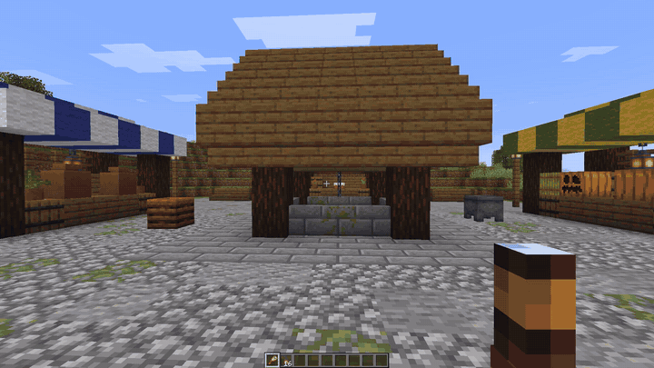
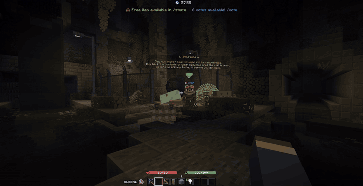
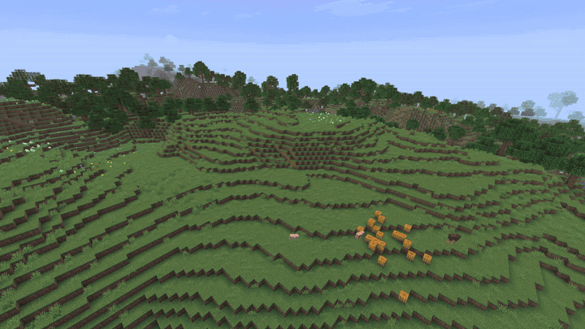
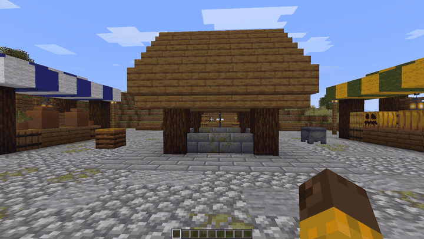
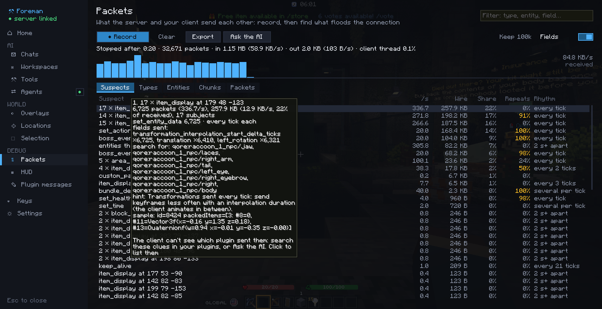
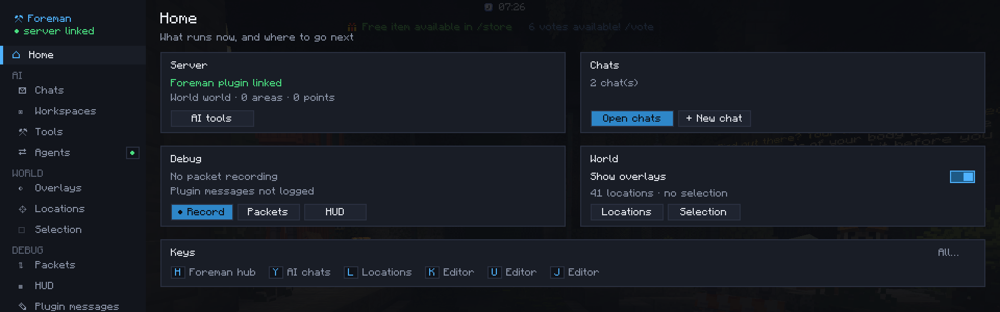
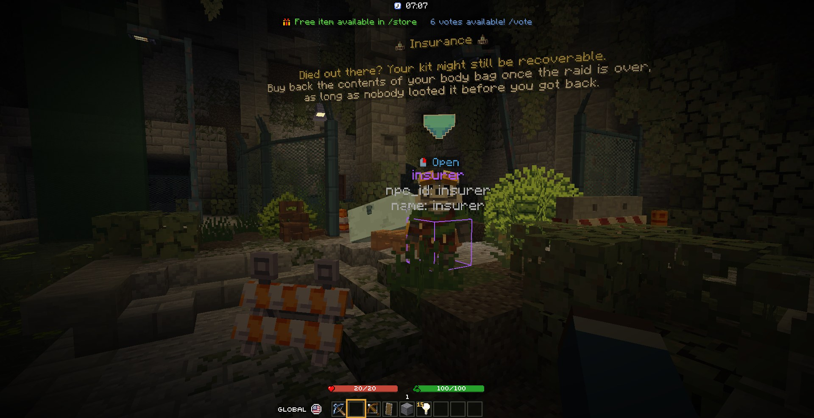
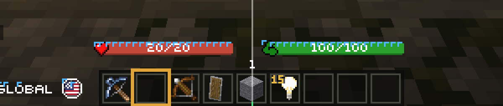
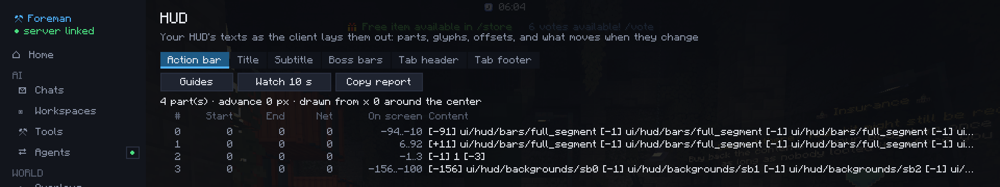
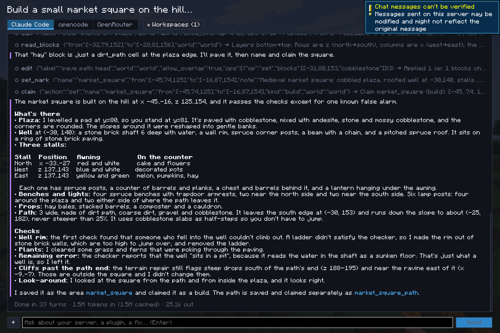

<p align="center"></p>

<h1 align="center">Foreman</h1>

A multi-tool for Minecraft server owners, admins and plugin developers. See what your server sends and draws, debug
your plugins on a running server, and work with an AI that can do the same: in game, or from your terminal.

Foreman is a **Fabric client mod** and an optional **Paper plugin** for Minecraft 26.3. The mod works on any server.
The plugin adds server-side tools when you install it. Nothing runs until you use it: no recording, no overlay, no
listener doing work in the background.

**Documentation: <https://qore-games.github.io/foreman/>**

## See it in action

| | |
|---|---|
|  |  |
| **Fix a plugin's bug** from in game: the chat reads the log, fixes the config, reloads the plugin, tries again | **Find what floods the connection**: record, then *Ask the AI* to trace each suspect to its code |
|  |  |
| **Build a place** from one prompt, graded, checked and undoable | **Ask for things in game**: it sees your screen and runs commands as you |

The prompts and what each run did: [Examples](https://qore-games.github.io/foreman/ai/examples/).



## What it does

### In the client, on any server

- **Packet viewer.** Record what the server and your client send each other. You get each packet's type, its size on
  the wire, what it's about (an entity, a chunk, a plugin channel), its fields, and how long your client took to
  handle it. *Suspects* groups the traffic by what probably sent it (a model's parts, a boss bar, the action bar, a
  plugin channel…) and shows what to search for in your plugins to find it.
- **HUD inspector.** See how the client lays out your server's action bar, titles, boss bars and tab list, glyph by
  glyph, and find the part that makes a line shift. Guides over the HUD, a watch for glyphs that move, and a check of
  your declared glyph widths against what the client draws.
- **Fast pack reloads.** F3+T and server packs reload about nine times faster, with the same textures, models and
  fonts: a 70 MB pack takes 1 second instead of 9. The game stays playable meanwhile, under a thin progress bar
  instead of the loading screen. The reload's warnings and errors are listed by kind, and a chat finds their cause in
  your pack's sources.
- **Plugin locations.** Plugins send their locations (NPCs, spawns, regions, waypoints…) and the mod draws them in the
  world, by source and category. Staff can teleport to them and move them with a gizmo, and the plugin gets the new
  position. Local sets keep your own lists of points on your computer.
- **Plugin messages.** A log of what plugins send on their channels, both ways, a colour per channel; click one to see
  its decoded text and a hex/ASCII dump, pause the stream to read it, filter, or mirror it to chat or the game's log.
- **WorldEdit selection.** Your WorldEdit selection drawn in the world in any shape (cuboid, sphere, ellipsoid,
  cylinder, polygon, convex), on any server with WorldEdit. Its tool sets the positions on blocks however far, and
  moves or resizes the selection with a gizmo.
- **Small helpers.** A selection box of your own with a gizmo, and keys that copy your position.

| | |
|---|---|
|  |  |
| The hub (H): every tool, grouped | Plugin locations in the world |
|  |  |
| HUD guides over the action bar | The HUD inspector |

### With the server plugin

- **Dev-server tools.** Run a command and get everything it printed: replies, log lines, exceptions. Read the server
  log since the last plugin reload, find plugins running an older jar than the one on disk, reload a plugin through
  PlugMan, check TPS and memory, profile the server thread by plugin, and list an event's listeners in call order.
- **Your other plugins, understood.** Skills teach the AI the commands of WorldEdit, WorldGuard, MythicMobs,
  ModelEngine, LuckPerms, PlaceholderAPI, CoreProtect, EssentialsX, Citizens, TAB and Skript, each offered only while
  its plugin runs and costing one line until it's needed. Add your own as a markdown file, or let the AI save the
  workflows it worked out.
- **Dupe testing.** Hunt item duplication before your players do: count every copy of an item on the server, have the AI
  try the dupe tricks against a plugin's menus and shops (same-tick clicks, shift and swap spam, collect, drop races,
  mules, reconnects), then count again — a bigger total is a dupe, and the audit says which plugin let it through. Each
  dupe you patch becomes a test you re-run after every update. Gated on the plugin plus a `foreman.test` permission.
- **World tools** (with FastAsyncWorldEdit). Read and edit the world: any WorldEdit command on a box in one call
  ("replace the stone with 50% cobblestone"), renders, terrain, roads, schematics, whole buildings from editable
  templates, and checks that walk a build the way a player would. Every change can be undone.

### AI, with your own account

- **Chats in game.** Ask in plain words. The AI runs on your computer with your own Claude Code, opencode or OpenRouter
  account. It knows where you stand, what you're looking at and what you've selected. It can take screenshots, run
  commands as you, and read and edit the folders you give it (your plugins' configs and sources).
- **Outside agents.** Let Claude Code in a terminal use the client through MCP: screenshots, commands, the open screen
  (clicks, typing), entities, items, packets and the HUD inspector. Write the plugin in your editor and let the agent
  test it end to end in the running game.



### For plugin developers

- **Skills:** ship markdown files in your jar (`foreman/skills/`) to teach the AI your plugin, with no code and no
  dependency.
- **`ForemanTools`:** publish your plugin's own tools, commands and skills to the AI.
- **Location API (`foreman-paper`):** show your plugin's locations in the mod and receive the moves staff make,
  with or without the Foreman plugin.
- **`ForemanWorlds` and `FurnitureProvider`:** read the areas and points Foreman keeps in each world, and offer your
  furniture to the world tools.

### For AIs

The docs in one file for an AI to read: <https://qore-games.github.io/foreman/llms-full.txt> (index:
[llms.txt](https://qore-games.github.io/foreman/llms.txt)). Prompts to paste into your agent, to connect it to Foreman
or add Foreman support to your plugin: [Ask your AI to use Foreman](https://qore-games.github.io/foreman/ai/ask-your-ai/).
Working on Foreman itself: [AGENTS.md](AGENTS.md).

## Install

| | Requirements |
|---|---|
| **Client** (`foreman-1.1.0.jar` in `mods/`) | Minecraft 26.3, Fabric Loader, Fabric API, Fabric Language Kotlin. |
| **Server** (`foreman-server-1.1.0.jar` in `plugins/`) | Paper 26.3. FastAsyncWorldEdit for the world tools (optional: the rest works without it). |

Players with the `foreman.client` permission (ops by default) are connected to the server's tools when they join.
The plugin's MCP server listens on `127.0.0.1:25599` by default (see `plugins/Foreman/config.yml`), with the token in
`plugins/Foreman/mcp-token.txt`.

## Quick start

1. Join a server and press **H** to open the hub. Everything is there: chats, overlays, locations, packets, HUD,
   keys and settings.
2. Record the traffic: `/packets start 20`, then `/packets` to see what flooded the connection.
3. Inspect the HUD: `/hud guides action_bar`, or ask an outside agent to run `ui_capture`.
4. Chat with the AI: press **Y**. On Flatpak launchers, see
   [Flatpak launchers](https://qore-games.github.io/foreman/getting-started/flatpak/) first.
5. Connect Claude Code in a terminal: in **H → AI → Agents**, allow agents outside the game and copy the `claude mcp add` command.

| Key | Does |
|---|---|
| H | The hub |
| Y | AI chats |
| B | Selection tool |
| L | Plugin locations |
| F6 / F7 | Copy your exact / block position |

Every key can be changed in the hub or in Minecraft's controls.

| Command | Does |
|---|---|
| `/packets [start [seconds] \| stop \| clear \| export \| ask]` | The packet viewer |
| `/hud [guides [element]]` | The HUD inspector |
| `/fastreload [on \| off]` | Reload the resource packs; fast reloads on or off |
| `/locations`, `/local` | Plugin locations and your local sets |
| `/ai [ask <prompt> \| new \| cancel \| tools]` | AI chats |
| `/foreman` (server) | Areas, undo, assets, tokens, tools, world data, status |

## Building

```sh
./gradlew build
./gradlew publishToMavenLocal
```

The client jar is in `client/build/libs/`, the plugin in `server/build/libs/`. The modules are `api` (the location
protocol), `paper` (its Paper side), `server` (the plugin), `server-api` (what other plugins compile against) and
`client` (the mod).

## License

[MIT](LICENSE): use it, change it, share it and build on it for any purpose, commercial servers and paid plugins
included.
