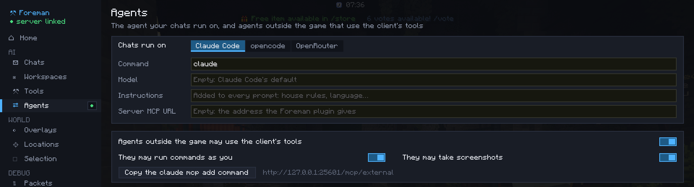

# Backends

Pick the backend of new chats in the hub's **AI → Agents**, with its settings under it. Each chat keeps the backend it
started with.

=== "Claude Code"

    Runs `claude` on your computer with your own login, in print mode, with two MCP servers: `client` (this client's
    tools) and `minecraft` (the Foreman server, when there is one). It has their tools and, on the chat's folders,
    its own file tools: none of Claude Code's other tools, whose definitions would cost every request. Their tools are
    loaded when needed (Claude Code's tool search).

    Settings: the command (default `claude`), the model (an alias like `opus` or `sonnet`, or a full name; empty:
    Claude Code's default) and the effort (`low`, `medium`, `high`, `xhigh`, `max`; empty: its default).

=== "opencode"

    Runs `opencode run` on your computer with the same two MCP servers, and its file tools on the chat's folders.

    Settings: the command (default `opencode`), the model (`provider/model`) and the effort, a variant of the model
    (`provider/model#high`).

=== "OpenRouter"

    Talks to OpenRouter from the game, with your API key. No program to install, and no Flatpak permission needed.

    To keep each request small, the model starts with a few tools (the player's basics, the chat's files, the
    server's skills) and the names of the others by group (Screens, Packets, Inspect, Edit, Server…, and each plugin
    that publishes tools); it loads the groups a task needs, which the chat then keeps. When you send a new prompt,
    what the earlier ones got back is cut down: their images are dropped and long tool results keep their start. A
    chat stays on one provider, and Anthropic's models are asked to cache the conversation.

    Settings: the API key, the model (default `anthropic/claude-sonnet-5.5`) and the reasoning effort (`low`,
    `medium`, `high`; empty: the model's default).

The model and effort are the defaults of new chats: each chat can choose its own ([model and
effort](chats.md#model-and-effort)).

## Other settings

- **Instructions:** given to each chat with its first prompt, and again when you change them (house rules, language…).
- **Server MCP URL:** the address of the Foreman plugin's MCP endpoint, when the one the server announces is wrong for
  your computer (see the server's `mcp.public-url`). Empty: the server's.

All of them are stored in `config/foreman/settings.json`, readable by you only.
