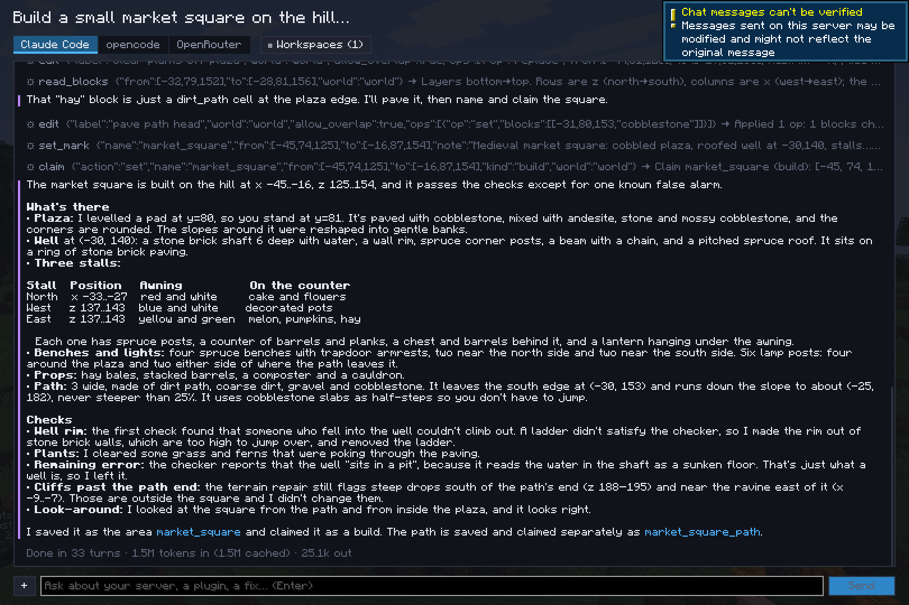
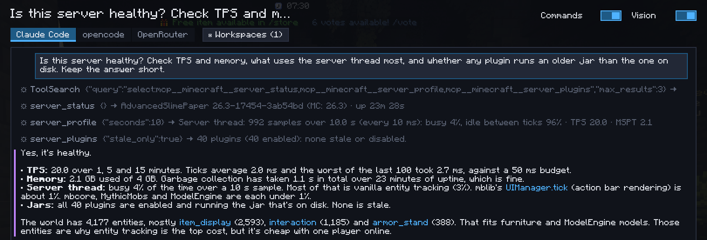

# Chats

Press ++y++ (or `/ai`) to open the chats. Each chat has its own transcript and backend, and runs on its own: start
one, switch to another while it works. The hub's Chats section lists them all, whatever the server, and the HUD shows
the ones at work.

<video src="../assets/videos/ai-ingame.mp4" controls muted loop playsinline preload="metadata" width="100%"></video>

=== "A build's report"

    

=== "A server's health"

    

## What a chat knows

Each prompt carries your context: your position and facing, the block or entity you're looking at, your
[selection](../client/selection.md) and your WorldEdit selection. "Here", "this" and "where I look" mean them.

On a server without the Foreman plugin, the chat is told which server tools are missing, so it says so in one line
instead of looking for a workaround.

## Across servers

Every chat is listed on every server: a conversation about a plugin can start on your dev server and continue on
staging. Each chat remembers the server it was last used on (shown next to it when it's another one), and when you
continue it elsewhere the AI is told: the positions, areas and edits earlier in the chat are in the other server's
world, and its tools now act on this one.

## What a chat may do

- **Folders:** the folders of its [workspaces](workspaces.md) and any folder added to this chat only. The AI reads and
  edits files only there, and runs in the first one.
- **Commands** (switch at the top of the chat): run commands as you, with your permissions.
- **Vision** (switch at the top of the chat): take screenshots of your view.

## Starting points

- `/ai ask <prompt>` sends a prompt in a new chat from the chat bar.
- `/packets ask` starts a chat that looks for what lags in the [packet recording](../client/packets.md).
- *Ask a chat* on the hub's Home page, or the *Ask the AI about the selection* key, starts a chat about the selected
  area.
- On a server with the plugin, its [prompts](../server/lessons-prompts.md#prompts) are ready-made tasks.

`/ai cancel` stops every running chat. Chats are saved in `config/foreman/chats/<server>/`.
