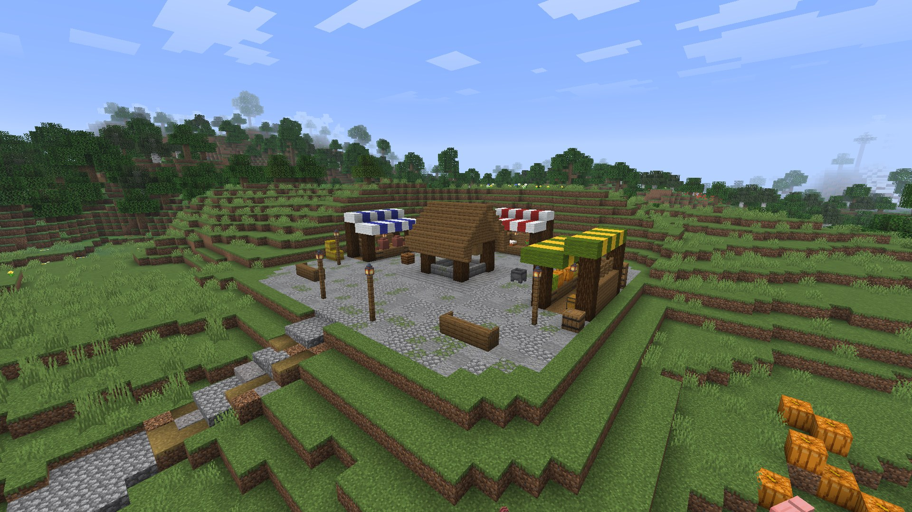

# Examples

Real runs, recorded in game and sped up. Each is one prompt in a chat (++y++) with Claude Code, on a dev server with
the Foreman plugin; the transcript shows every tool the AI calls.

## Fix a plugin's bug

<video src="../assets/videos/ai-debug.mp4" controls muted loop playsinline preload="metadata" width="100%"></video>

> /shop buy sword says "An internal error occurred". Find out why and fix it, then check that it works.

The chat was given the plugin's folder (its workspace switches, then *Folders of this chat only*). It read the
server's log with the stack trace (`server_log`), found the typo in the plugin's `config.yml` (`DIAMOND_SWORDD`), fixed
it, marked the log (`server_log_mark`), reloaded the plugin through PlugMan (`server_reload_plugin`), ran
`/shop buy sword` as the player, and checked that nothing new was logged. 11 turns.

## Build a place

<video src="../assets/videos/ai-build.mp4" controls muted loop playsinline preload="metadata" width="100%"></video>

> Build a small market square on the hill around x -30, z 140: a level cobbled plaza with a well in the middle, three
> market stalls with colored awnings around it, benches and lanterns, and a path leading down the slope. Medieval
> style, about 30 by 30 blocks. Don't ask me anything: decide yourself, check it, and tell me when it's done.

It measured the site, graded the hill into a pad with banks, built in labelled steps (each one an undo step, shown in
chat to ops), laid the path down the slope, then ran `check`, which walks the build like a player, and fixed what it
reported (a well you couldn't climb out of). It looked at the result in first person before saying it was done, and
named and claimed the area. About four minutes.

## Find what floods the connection

<video src="../assets/videos/packets-ask-ai.mp4" controls muted loop playsinline preload="metadata" width="100%"></video>

Record the packets, then *Ask the AI* in the packet viewer. The chat read the recording (`packets_suspects`,
`packets_list`), followed the clues into the plugins' sources in its workspace, and named the code behind each: an
NPC's model parts resending their transformations every tick, an action bar and boss bars resent unchanged. Then it
proposed the changes, with the code.

## Do something in game

<video src="../assets/videos/ai-ingame.mp4" controls muted loop playsinline preload="metadata" width="100%"></video>

> What am I looking at? Then make it sunset, and give me a spyglass and 16 lanterns.

It took a screenshot to see what you see, described it, and ran the commands as you (`client_run_command`). Turn off
*Commands* or *Vision* in a chat's header to forbid either.

## More to ask

- *Replace all the stone in this box with 50% stone and 50% cobblestone.* One `worldedit` call
  (`//replace stone 50%stone,50%cobblestone`); a run measured 3 turns. See [Plugin integrations](../server/integrations.md).

- *Why is the server lagging?* `server_status`, `server_profile` (the server thread by plugin) and the log.
- *Did my deploy work?* `server_plugins` says whether each plugin runs the jar on disk or an older one.
- *Which listeners run on `PlayerInteractEvent`, in what order?* `server_listeners`.
- *My boss bar text jumps when the number changes: why?* The HUD inspector's tools (`ui_capture`, `ui_watch`) measure
  each glyph.
- *Open the settings menu and check that every button works.* Screen tools: `client_screen`, `client_click`.
- *Give the tavern a second floor, in the style of the houses around it.* World tools, with the
  [world's profile and templates](../server/building-templates.md).
