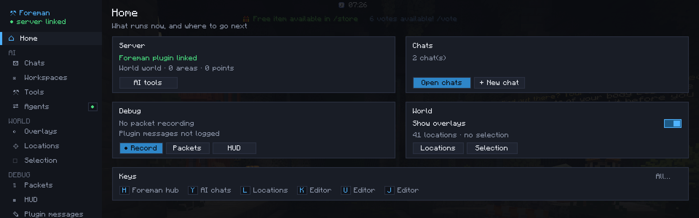

# The hub

++h++ opens the hub, ++l++ opens it on Locations. A rail of sections on the left,
grouped by what they're for, with each feature's settings on its own page:

| Group | Sections |
|---|---|
| | **Home**: is the Foreman plugin linked, the running chats, the packet recording, the overlays and your selection, your keys |
| **AI** | **Chats**, **Workspaces**, **Tools** (every tool the AI can use, by provider), **Agents** (the backend chats run on, agents outside the game) |
| **World** | **Overlays** (what's drawn in the world), **Locations** (sources and categories, the location editor and its snap), **Selection** (your selection tool, the WorldEdit selection and its tool) |
| **Debug** | **Packets** (the packet viewer and its settings), **HUD** (the HUD inspector), **Plugin messages** (a log of what plugins send on their channels) |
| | **Keys** (by group; click a key, press the new one), **Settings** (where each setting is, the config folder, links) |

The rail shows badges: the number of chats at work, a red dot while packets are being recorded, and a dot on the
sections whose tool or log is on (the selection tool, the location editor, HUD guides, the plugin message log, outside
agents).

## Overlays

Each layer is **off**, **nearby** (around you only) or **always** (everything in range):

| Layer | What | Needs |
|---|---|---|
| Locations | What plugins send | a plugin using the [location API](../developers/locations-api.md) |
| Areas | Named places, space reserved by builds, roads, zones | the Foreman plugin |
| Points | Spots builds recorded (containers, spawns…) | the Foreman plugin |
| Check issues | What the last `check` found, numbered | the Foreman plugin |
| Last AI change | The box the AI just changed, fading out | the Foreman plugin |

The section also has the master switch, drawing through blocks, a notice when you enter or leave an area, the areas
you're in on the HUD, and the distances (nearby from, labels within).
