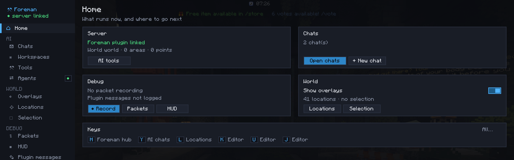

# The hub

++h++ opens the hub, on the section it was closed on (with its search), after a restart too. A rail of sections on
the left, grouped by what they're for, with each feature's settings on its own page:

| Group | Sections |
|---|---|
| | **Home**: is the Foreman plugin linked, the running chats, the packet recording, the overlays and your selection ([editor mode](editor.md) from there), your keys |
| **AI** | **Chats**, **Workspaces**, **Tools** (every tool the AI can use, by provider), **Agents** (the backend chats run on, agents outside the game) |
| **World** | **Overlays** (what's drawn in the world), **Locations** (sources and categories, the location editor and the move snap of every gizmo), **Selection** (your selection tool, the WorldEdit selection and its tool), **Library** (the server's [assets](library.md): browse, turn around, place), **Models** (the [item models](models.md) of the loaded packs in 3D: browse, place), **Displays** (the [display editor](displays.md): its selection and keys), **History** (the server's changes: [below](#history)) |
| **Debug** | **Packets** (the packet viewer and its settings), **HUD** (the HUD inspector), **Plugin messages** (a log of what plugins send on their channels), **Resource packs** (fast reloads, the last one's steps and issues) |
| | **Keys** (by group; click a key, press the new one; then editor mode's tools and their keys), **Settings** (where each setting is, the config folder, links) |

The rail shows badges: the number of chats at work, a red dot while packets are being recorded, and a dot on the
sections whose tool or log is on (the selection tool, the location editor, the placement tool, HUD guides, the plugin
message log, outside agents).

The building tools' cards (Selection, Locations, Library, Displays) show the keys that open them ([editor
mode](editor.md)'s key, then the tool's number); their **Use** button closes the hub and opens editor mode on that
tool.

## History

With the Foreman plugin on the server, **World → History** lists the changes made with Foreman since the server started
(its `history` tool: your AI's edits, yours, the regions and display tools'), newest first: what, when, who, the world
and the size of the box it changed. Yours by default; **Everyone's** when the server lets you read them (`foreman.admin`).

- **Teleport** takes you above the box (the game's `/tp`, an operator's) and closes the hub.
- **Undo** on your own changes undoes back to that one: your last change, or **Undo to here** for an older one, which
  undoes your later ones too (click twice). The server refuses to undo a change someone else changed over since, or
  one inside an area another player [locked](../server/world-context.md#locks), and the page shows why.

The page asks the server when it opens and on **Refresh**: nothing is read while it's closed.

## Overlays

Each layer is **off**, **nearby** (around you only) or **always** (everything in range):

| Layer | What | Needs |
|---|---|---|
| Locations | What plugins send | a plugin using the [location API](../developers/locations-api.md) |
| Areas | Named places, space reserved by builds, roads, zones | the Foreman plugin |
| Points | Spots builds recorded (containers, spawns…) | the Foreman plugin |
| Check issues | What the last `check` found, numbered | the Foreman plugin |
| Last AI change | The box the AI just changed, fading out | the Foreman plugin |
| Pasted copies | Where the library's [assets](library.md#pasted-copies) were pasted: their box, asset and points | the Foreman plugin |

Two checks of the world come next, each on or off (and on ++x++ / ++l++ in [editor mode](editor.md)):

- **Hidden blocks**: barriers, light blocks, structure voids and what the resource packs draw as nothing, outlined
  around you, each kind in its colour ([details](editor.md#hidden-blocks)); its radius, 16 to 64 blocks.
- **Displays per chunk**: the display and interaction entities of each chunk around you, the chunk green, yellow or red
  by how many, and the loaded totals on the HUD ([details](editor.md#displays-per-chunk)); the yellow and red
  thresholds.

The section also has the master switch, drawing through blocks, a notice when you enter or leave an area, the areas
you're in on the HUD, and the distances (nearby from, labels within).
