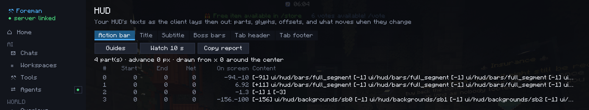
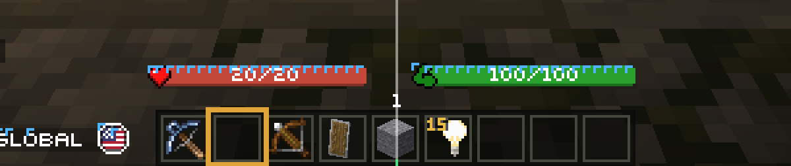

# HUD inspector

Shows how the client lays out your server's HUD texts, glyph by glyph: what you need to build HUDs out of font glyphs
without them shifting when the text changes.

Elements: `action_bar`, `title`, `subtitle`, `boss_bar`, `tab_header`, `tab_footer`, `screen_title`.

## In game

- `/hud` opens the hub's HUD section: each element's parts (the root text, then each child, the way HUD plugins
  compose a line), where each part starts and ends, and the part that doesn't come back to where it started.
- `/hud guides [element]` draws guides over one element: the screen's center, where each part starts and where it
  leaves the cursor (in red when it doesn't come back), and the left edge of each glyph.

## For the AI and outside agents

| Tool | Does |
|---|---|
| `ui_capture` | An element's layout: parts, glyphs by texture with their real advance and position, the problems found, and a zoomed image |
| `ui_watch` | Watches an element for a few seconds and reports every glyph that moved, and the part whose text changed; it can run a command to trigger the change |
| `ui_measure` | The same report for a text you give (a text component's JSON, or text with a font), without showing it |
| `ui_glyphs` | The glyphs the loaded resource packs declare, by font: character, texture, height, ascent, advance |
| `ui_check_widths` | Checks the widths your server declares (glyph definitions, a font width table) against what the client draws |

!!! tip
    A part that leaves the cursor off moves everything after it, and a centered line moves by half its width change.
    `ui_capture` names both.
