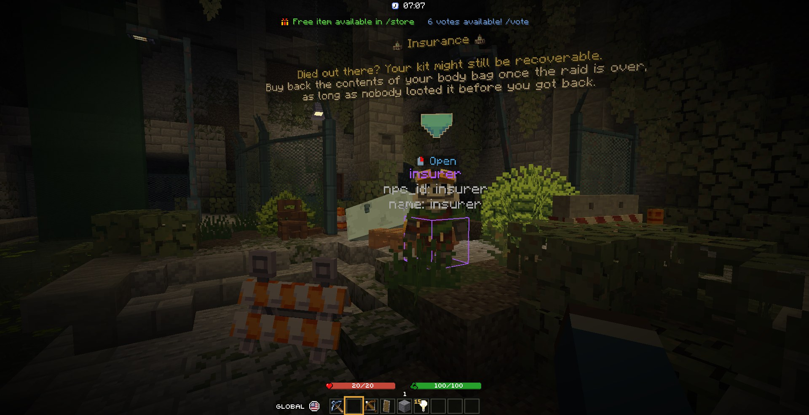

# Locations and local sets

Plugins send their locations (NPCs, spawns, regions, waypoints…) to players with the permission, and the mod draws
them in the world: each **source** (a plugin) has **categories**, each shown or hidden. Staff can teleport to them and
move them; the plugin receives the move and saves it. To send locations from your plugin, see the
[location API](../developers/locations-api.md).

## Viewing

The hub's Locations section (++l++) lists the sources and their categories: show or hide each, show only one source,
teleport to the nearest location of a category. The Locations layer of the [overlays](hub.md#overlays) sets how far
they're drawn.

## Editing

Turn on the location editor (`/locations editor`, or its key, unbound by default): left click a location to select
it, drag the gizmo's arrows, right click a block to place it there. Moves snap to a step (the gizmo snap setting in
the Locations section; hold ++ctrl++ to move freely).

| Key | Moves the selected location |
|---|---|
| ++k++ | to your feet |
| ++u++ | to your eyes |
| ++j++ | to your block |

| Command | Does |
|---|---|
| `/locations list [source]` | Sources, or a source's categories |
| `/locations toggle <source> [category]` | Show or hide |
| `/locations add <source> <category> [k=v…]` | Ask the plugin to add one where you stand |
| `/locations relocate [x y z]` | Move the selection (default: your block) |
| `/locations rename <name>` | Rename it; `rename source <s>`, `rename category <c>` move it to another source or category |
| `/locations delete` | Delete it (for plugin locations: on this client only, the plugin keeps it) |
| `/locations gizmo` | Show or hide the arrows |
| `/locations clear`, `status` | Forget every received location (they come back with the next update), count them |

## Local sets

Your own lists of points, kept on your computer in `config/foreman/local-locations/<set>.yaml`. The active set is
shown and edited like a source named `local:<set>`, and every change is saved. They need no plugin and follow you from
server to server. What they're for:

- **Playtest notes.** Walk a map and drop a point wherever something's wrong (`/local add bugs door won't open`,
  `/local add todo needs a light`), then fix them one by one with the points drawn in the world, or give the file to a
  chat: each point has its world, position and label.
- **Positions for a config, before the plugin exists.** Place the spawns, loot spots or waypoints of a feature you're
  writing, move them with the gizmo until they're right, then copy them from the YAML (`world;x;y;z;yaw;pitch`) into
  your plugin's config.
- **Servers you can't add a plugin to.** Building on someone else's server, keep your own markers: the build's
  corners, where the next pieces go.
- **Camera points.** Exact positions and angles for screenshots, trailers or a cinematic plugin's keyframes.

| Command | Does |
|---|---|
| `/local create \| delete \| use <name>` | Manage sets, pick the active one |
| `/local add [category] [label]` | Add your position to the active set |
| `/local rename <new name>` | Rename the active set |
| `/local save \| load <name>` | Write or read a set file |
| `/local list \| saved \| active`, `/local stop` | List them, hide the active set |
