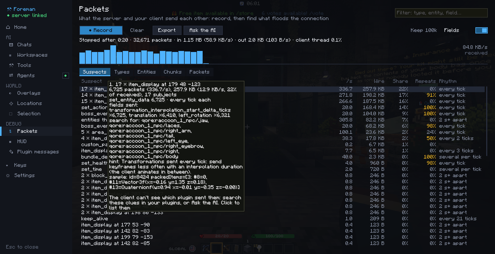

# Packet viewer

Records what the server and your client send each other, and helps find what floods the connection or stutters the
client. Nothing runs while it isn't recording.

## Recording

| | |
|---|---|
| `/packets start [seconds]` | Start (until `/packets stop`, or for that long) |
| `/packets stop` | Stop |
| `/packets` | Open the viewer (the hub's Packets section) |
| `/packets clear` | Drop the recording |
| `/packets export` | Write everything to `config/foreman/packets/` |
| `/packets ask` | A new chat looks for what lags in the recording |

A key to start and stop a recording is in the hub's Keys section, unbound by default. While recording, the HUD shows
the time and the bytes per second.

## What you see

- **Each packet:** type, direction, size on the wire after compression, what it's about (an entity, a chunk, a plugin
  channel), its fields, and how long the client took to handle it.
- **Suspects:** the traffic grouped by what likely sends it (a model's parts, a boss bar, the action bar, a plugin
  channel…), how often it's resent, how much of it repeats unchanged, which entity fields change, and what to search
  for in your plugins: item models, custom data keys, translation keys, texts.
- **Totals:** the types, entities and chunks that get the most, and the bytes per second.

## Settings

In the Packets section: whether to keep each packet's fields (not only type and size), and how many packets a
recording keeps one by one (20,000 to 500,000; the oldest go first, the totals always cover the whole recording).

## With the AI

<video src="../assets/videos/packets-ask-ai.mp4" controls muted loop playsinline preload="metadata" width="100%"></video>

*Ask the AI* (`/packets ask`) starts a chat that reads the recording with the `packets_*` tools, searches your
workspace folders (plugin sources, server configs, language files) for the clues, and proposes the change. Give the
chat a [workspace](../ai/workspaces.md) with your plugins' sources first. Outside agents get the same tools
([reference](../ai/tools.md#packets)).

