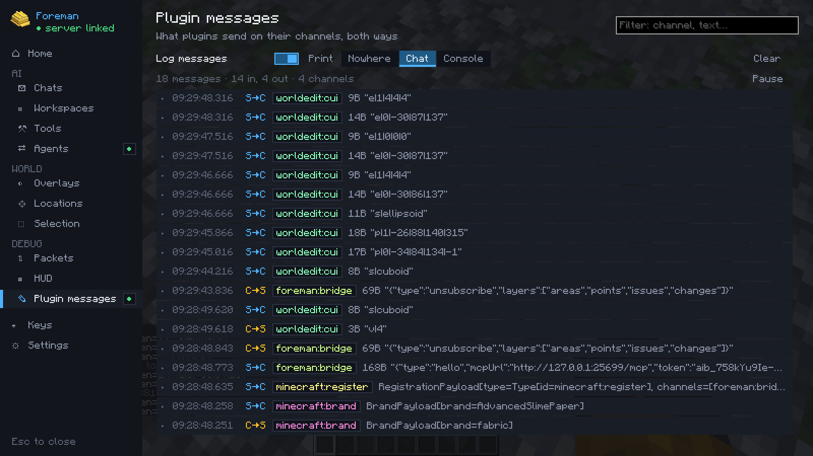

# Plugin messages and helpers

## Plugin messages

Logs the plugin messages (custom payloads) your client sends and receives, both ways: in the hub's **Debug →
Plugin messages**, the last 500 as a row each — time, direction, a colour per channel, size and a preview. The header
counts them (in / out / channels), **Pause** freezes the list so a fast stream holds still while you read, and you can
filter by channel or text. Nothing is kept while logging is off.

**Click a message** to open it: the decoded text (readable for the JSON and strings most plugins send) and a hex +
ASCII dump of the raw bytes, so a binary payload is legible too.

They can also be printed (**Print**) to chat, a line each as the hub's rows read (direction, the channel in its colour,
size, a preview; hover for the whole text, click to copy it), or to the game's log, as lines like
`Plugin message S→C <channel> <bytes>B "<text>"`.

The [packet viewer](packets.md) counts plugin channels too, by size and rate, to find the one that floods the
connection.

## Copy your position

| Key | Copies |
|---|---|
| ++f6++ | Your exact position (`x y z`) |
| ++f7++ | Your block position |
