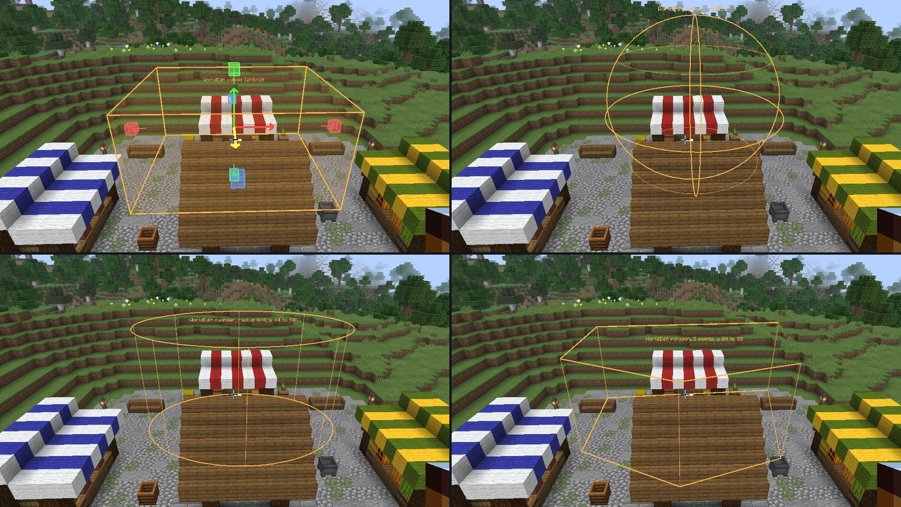

# Selection

## Your selection

A box in the world, for the AI or your own commands. Press ++b++ (or use the hub's Selection section), then left click
and right click the two corners, and drag the gizmo to adjust it.

The AI chats are told about it and about the WorldEdit selection: "here", "this" and "the selection" mean them. The
hub's *Ask a chat* button, or the *Ask the AI about the selection* key (unbound by default), starts a chat about the
selected area. `/ai selection clear` clears it.

## The WorldEdit selection

On a server with WorldEdit or FastAsyncWorldEdit, the mod shows your WorldEdit selection in the world, whatever its
shape: cuboid, sphere, ellipsoid, cylinder, polygon, convex. It's what WorldEdit tells a CUI client, so it works
without the Foreman plugin. Turn it off in the hub's **World → Selection** (*Show the WorldEdit selection in the
world*).

The **WorldEdit tool** (hub's Selection section, or its key, unbound by default) edits it:

- **Left / right click a block** for `//pos1` / `//pos2`, however far the block is. What they mean depends on the
  selector, as with the wand: two corners, a center and a radius, the points of a polygon.
- **Drag an arrow** to move the selection (`//shift`), **a knob** to resize it. A sphere, an ellipsoid or a cylinder
  grows on both sides of its center; a polygon or a convex shape is stretched. The mod selects it again with the
  commands that make it, paced so the server's spam check never kicks you.

Off when the WorldEdit CUI mod (or WorldEdit itself) is installed: it draws the selection then.
