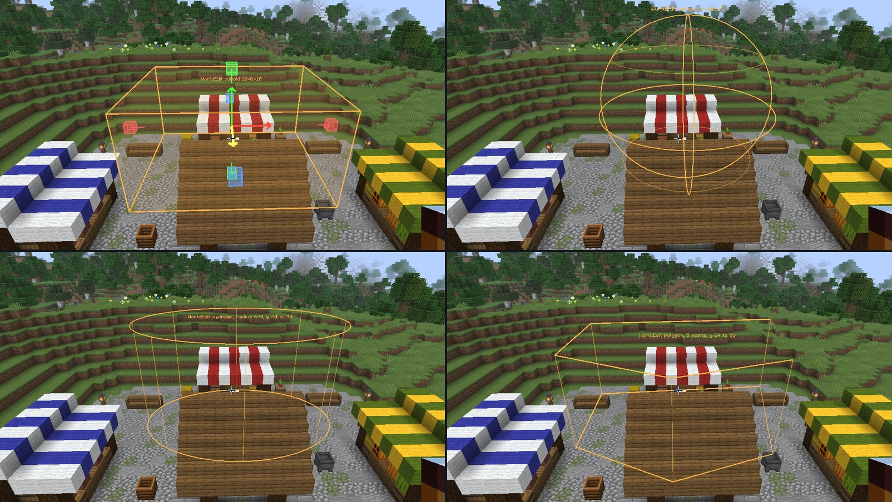

# Selection

## Your selection

A box in the world, for the AI or your own commands. Press ++b++ for [editor mode](editor.md) and ++1++ for the
selection tool (or **Use** in the hub's Selection section), then left click and right click the two corners (however far
the blocks are, up to 256 blocks), and drag the gizmo to adjust it (by whole blocks). ++enter++ asks a chat about it,
++delete++ clears it, ++p++ (or **Select in
WorldEdit** in the hub's Selection section) makes it your WorldEdit selection (`//sel cuboid`, `//pos1`, `//pos2`
sent as you), so WorldEdit's own commands (`//set`, `//copy`, `//replace`…) work on what you selected. On any server
with WorldEdit or FastAsyncWorldEdit, with the WorldEdit CUI mod too.

It is also the editor's one way of selecting things: the other tools make their new things from it (WorldEdit's
selection when you have no Foreman one). Select a box here, switch tool, and press its key: ++c++ in the
[asset tool](library.md#a-new-asset) makes an asset of it, ++m++ in [areas and points](regions.md#the-tool) an area.

The AI chats are told about it and about the WorldEdit selection: "here", "this" and "the selection" mean them. The
hub's *Ask a chat* button, ++enter++ with the selection tool, or the *Ask the AI about the selection* key (unbound by default), starts a chat about the
selected area. `/ai selection clear` clears it.

## Copy and paste

With the selection tool, on a server with the Foreman plugin:

| | |
|---|---|
| ++ctrl+c++ | Copies the selection into your clipboard, as it is now: its blocks with their block data, its entities (displays: furniture, and what plugins draw with them; markers where plugins keep data in the world; item frames, paintings, armor stands, mobs that stay; not players), the points, areas and [pasted copies](library.md#pasted-copies) lying in it |
| ++ctrl+x++ | Cuts it: copies it, then takes all that out of the world (its blocks become air). One undo step (`/foreman undo` puts it back). Refused when an asset area lies in it: [move an asset](library.md#changing-an-asset) with the asset tool instead |
| ++ctrl+v++ | Places the clipboard with the [placement tool](library.md#placing), as an asset is placed: a [ghost](library.md#the-ghost) of it at the crosshair, as it was copied (not turned), ++r++ or the scroll wheel turns it, right click pins it (drag the arrows to nudge it), right click again or ++enter++ pastes it, ++z++ undoes your last change, ++esc++ (or a left click while it follows) goes back to the selection tool. Each ++enter++ pastes another |

The server keeps the clipboard, one per player (your AI chats share it), until it restarts: it survives leaving the
server, and a paste goes into any world of the server. What you copied stays as it was copied: changing the build
afterwards doesn't change the clipboard.

A paste is the [asset paste](../server/assets.md#clipboards): everything an asset carries, a clipboard carries, and each
paste is a copy of its own, recorded as a detached copy of `clipboard` (`clipboard-1`, `clipboard-2`… in the pasted
copies overlay, [selectable and deletable](library.md#pasted-copies) with the asset tool). Plugins following Foreman's
copies keep a paste's objects working on their own: a lamp wired to a switch in the room you copied reads the switch
of its own paste, not the original's nor another paste's. A copy of an asset lying in the selection is pasted as a copy
of that asset, nested in the paste, and still follows its asset.

## The WorldEdit selection

On a server with WorldEdit or FastAsyncWorldEdit, the mod shows your WorldEdit selection in the world, whatever its
shape: cuboid, sphere, ellipsoid, cylinder, polygon, convex. It's what WorldEdit tells a CUI client, so it works
without the Foreman plugin. Turn it off in the hub's **World → Selection** (*Show the WorldEdit selection in the
world*).

The **WorldEdit tool** (editor mode's tool 9, or **Use** in the hub's Selection section) edits it:

- **Left / right click a block** for `//pos1` / `//pos2`, however far the block is. What they mean depends on the
  selector, as with the wand: two corners, a center and a radius, the points of a polygon.
- **Drag an arrow** to move the selection (`//shift`), **a knob** to resize it (++ctrl++ held: both sides at once). A sphere, an ellipsoid or a cylinder
  grows on both sides of its center; a polygon or a convex shape is stretched. The mod selects it again with the
  commands that make it, paced so the server's spam check never kicks you.
- ++delete++ clears it (`//sel`), as does **Clear** beside it in the hub's Selection section.
- ++v++ hides it (or shows it again) everywhere, the tool included: the same as the hub's switch.

Off when the WorldEdit CUI mod (or WorldEdit itself) is installed: it draws the selection then.
