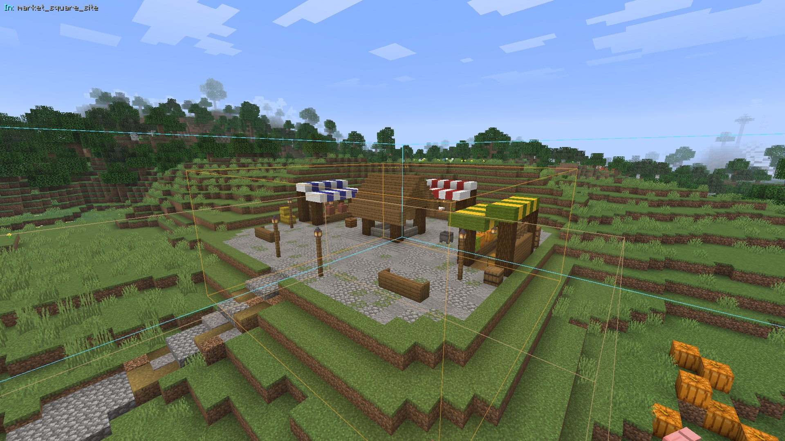
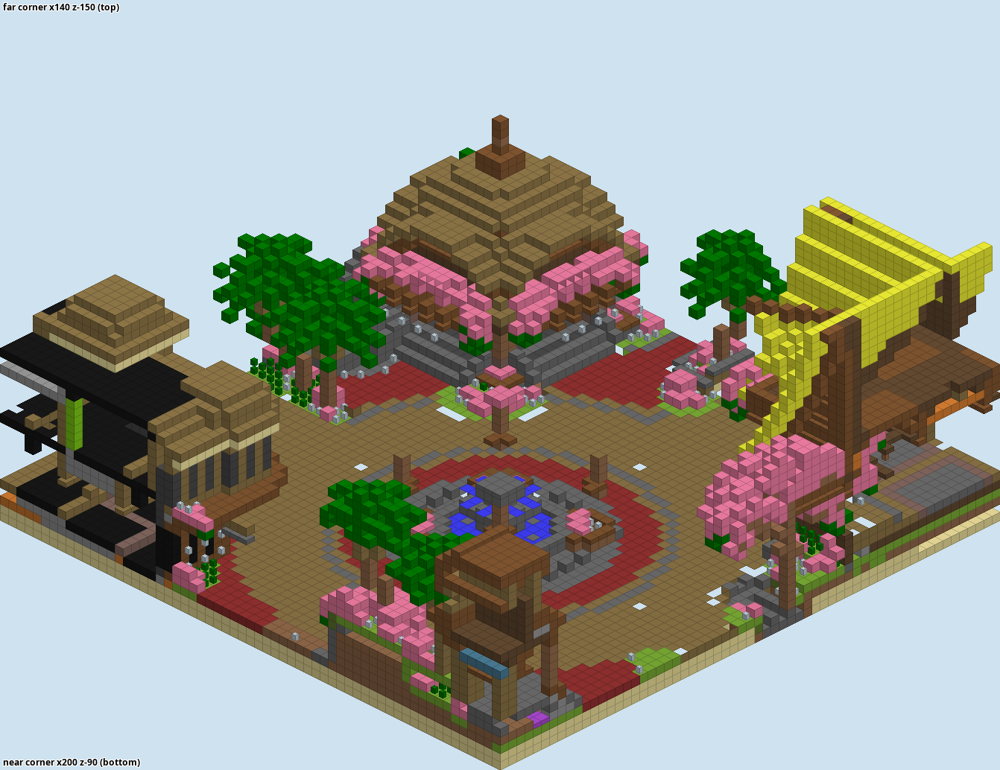
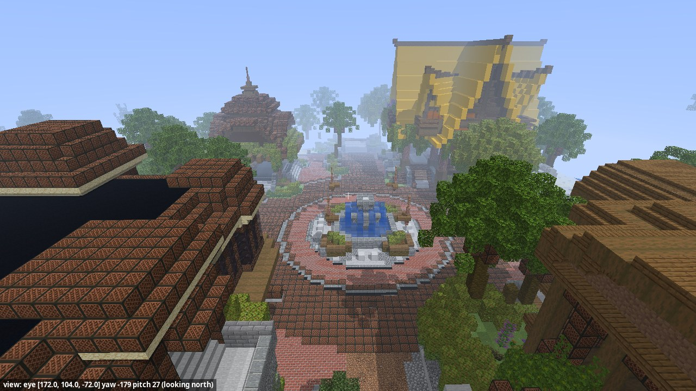
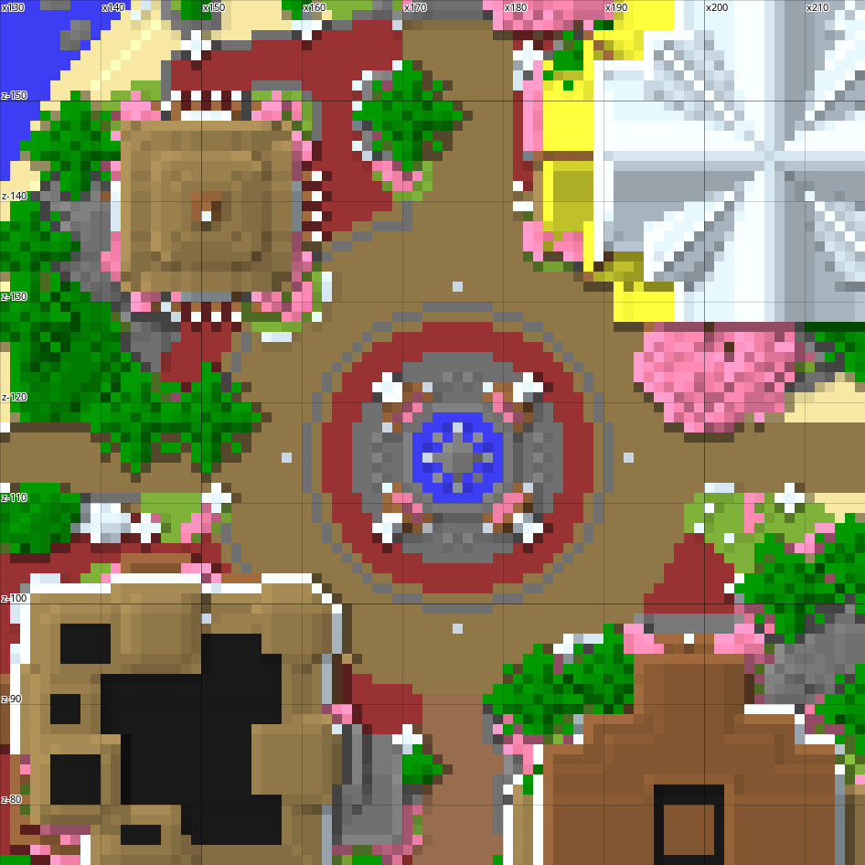

# World tools

With the plugin and [FastAsyncWorldEdit](https://modrinth.com/plugin/fastasyncworldedit), the AI can read and edit
the world. It looks before it builds, works in steps, checks its work the way a player would walk it, and every change
can be undone. Without FastAsyncWorldEdit these tools are off (`/foreman status` says so), and so are the areas,
overlays and furniture that go with them.

| | Tools |
|---|---|
| **Looking** | `get_context` (players, selections, areas, the world's profile, limits), `scan_area`, `read_blocks`, `find_blocks`, `render` (top, iso, plan, slope views), `look` (first person, textured) |
| **Editing** | `edit` (block operations: fills, shapes, roofs, doors, stairs, weathering, plants, trees…, all undone together), `transform_region` (move or copy, rotated) |
| **Terrain** | `make_ground`, `grade`, `foundation`, `blend_terrain`, `smooth_terrain`, `make_fields`, `build_path` (walkable roads over the relief) |
| **Buildings** | `build_structure` (a whole building from [templates](building-templates.md)), `demolish` (puts the land back), `list_styles` |
| **Library** | `list_assets`, `preview_asset`, `paste_asset`, `scatter_assets`, `save_asset` ([schematic library](assets.md)) |
| **Displays** | `list_displays`, `edit_displays` (move, turn, scale, stretch), `spawn_display`, `remove_displays`, `list_models` ([displays and models](displays.md)) |
| **Objects** | `object_kinds`, `list_objects`, `place_objects`, `edit_objects`, `remove_objects`: what plugins draw with entities and declare ([world objects](../developers/world-objects.md)) |
| **Checking** | `check`, `measure_site`, `repair_terrain`, `connect_doors` |
| **Context** | `set_mark`, `claim`, `world_profile`, `points` ([world context](world-context.md)) |
| **Undo** | `undo` reverts your own changes, furniture, displays and objects included, `history` lists them ([undo](#undo)) |

## check

`check` walks an area like a player and reports, with coordinates: unreachable rooms, seats and containers, steps that
need a jump, blocked doors, wrong double-door hinges, furniture in front of doors or inside walls, sunk or floating
builds, cliffs, steep or broken roads, floating blocks and overlapping claims. The client draws what it found as the
*Check issues* overlay.

## Undo

Every change is one undo step, recorded in the history of whoever made it: each player has their own (their AI's
calls with their token or through the relay, and their commands), and the console shares one with the server's token.
`undo` and `/foreman undo [count]` take back your own last changes, newest first, never someone else's.

Undoing a change puts back the blocks as they were before it, so it would wipe what others built there since. When a
later change by someone else overlaps its box (blocks or entities it touched), undo refuses it and says whose change
and where; `force: true` (`/foreman undo [count] force`) undoes it anyway. With `foreman.admin` you can undo someone
else's: `undo {player: "Alex"}`, `/foreman undo [count] [player] [force]` (`console` for the console's history).

`history` and `/foreman history [player]` list the recent changes, newest first: when, who, the label, the world and
box, the blocks changed. You see your own; with `foreman.admin` (or the server's token) everyone's, or one player's.
Each history keeps 50 changes; snapshots of WorldEdit commands share a budget of 8 million blocks across all of them,
the oldest changes leaving first. The history is in memory: a restart clears it.

## Watching the AI

Ops with `foreman.watch` see each change in chat (the tool, who asked, how long it took); what builders change
themselves in the mod's pages (panels, forms) isn't announced. The client draws the box the AI just changed as the
*Last AI change* overlay, with whose change it is.

## Furniture

Foreman has no furniture of its own. A furniture plugin can provide it by registering a
[`FurnitureProvider`](../developers/furniture.md): the AI then gets `list_furniture`, `place_furniture` and
`remove_furniture`, and generated buildings are furnished with it. Notes in `catalog/furniture.yml` are shown to the
AI next to each furniture id. [Display editing](displays.md#furniture) perfects the look of each furniture, its plugin
keeping track of it.

## Limits

`limits` in `config.yml` caps the blocks one call may edit, read or render; `get_context` tells the AI, which splits
large edits.

<video src="../assets/videos/ai-build.mp4" controls muted loop playsinline preload="metadata" width="100%"></video>

*A market square built from one prompt, with the overlays of the AI's changes ([the run](../ai/examples.md#build-a-place)).*

=== "`render` iso"

    

=== "`look`"

    

=== "`render` top"

    

The AI sees what it builds without a game client: `render` draws the blocks of a box from above, in plan or in
isometric views, `look` draws a first-person view with the game's textures.
