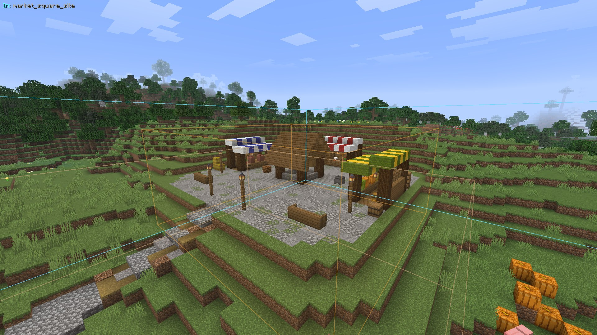
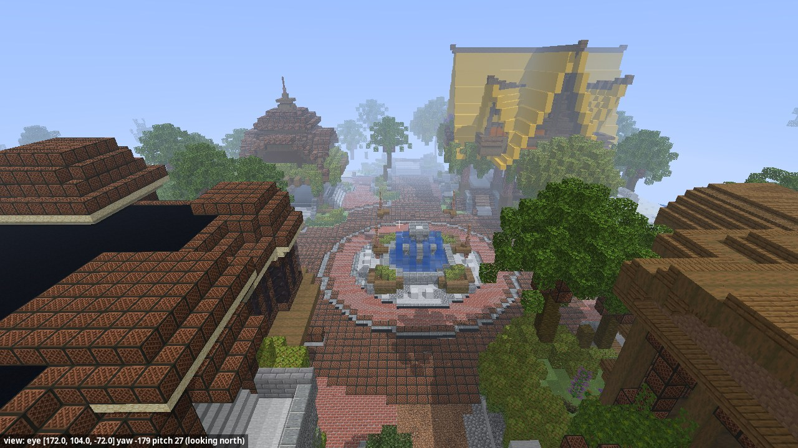
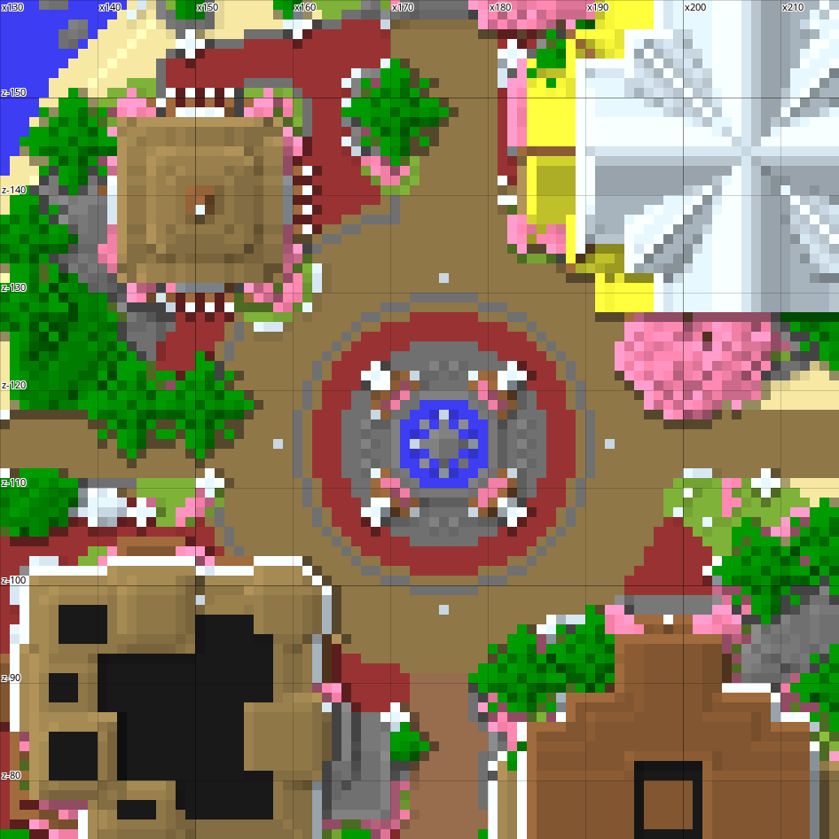

# World tools

With the plugin and [FastAsyncWorldEdit](https://modrinth.com/plugin/fastasyncworldedit), the AI can read and edit
the world. It looks before it builds, works in steps, checks its work the way a player would walk it, and every change
can be undone. Without FastAsyncWorldEdit these tools are off (`/foreman status` says so), and so are the areas,
overlays and furniture that go with them.

| | Tools |
|---|---|
| **Looking** | `get_context` (players, selections, areas, the world's profile, limits), `scan_area`, `read_blocks`, `find_blocks`, `render` (top, iso, plan, slope views), `look` (first person, textured) |
| **Editing** | `edit` (block operations: fills, shapes, roofs, doors, stairs, weathering, plants, trees…, all undone together), `transform_region` (move or copy, rotated) |
| **Terrain** | `make_ground`, `grade`, `foundation`, `blend_terrain`, `smooth_terrain`, `make_fields`, `build_path` (walkable roads over the relief) |
| **Buildings** | `build_structure` (a whole building from [templates](building-templates.md)), `demolish` (puts the land back), `list_styles` |
| **Library** | `list_assets`, `preview_asset`, `paste_asset`, `scatter_assets`, `save_asset` ([schematic library](assets.md)) |
| **Checking** | `check`, `measure_site`, `repair_terrain`, `connect_doors` |
| **Context** | `set_mark`, `claim`, `world_profile`, `points` ([world context](world-context.md)) |
| **Undo** | `undo` reverts AI changes, furniture included; `/foreman undo [count]` does too |

## check

`check` walks an area like a player and reports, with coordinates: unreachable rooms, seats and containers, steps that
need a jump, blocked doors, wrong double-door hinges, furniture in front of doors or inside walls, sunk or floating
builds, cliffs, steep or broken roads, floating blocks and overlapping claims. The client draws what it found as the
*Check issues* overlay.

## Watching the AI

Ops with `foreman.watch` see each change in chat (the tool, who asked, how long it took). The client draws the box the
AI just changed as the *Last AI change* overlay.

## Furniture

Foreman has no furniture of its own. A furniture plugin can provide it by registering a
[`FurnitureProvider`](../developers/furniture.md): the AI then gets `list_furniture`, `place_furniture` and
`remove_furniture`, and generated buildings are furnished with it. Notes in `catalog/furniture.yml` are shown to the
AI next to each furniture id.

## Limits

`limits` in `config.yml` caps the blocks one call may edit, read or render; `get_context` tells the AI, which splits
large edits.

<video src="../assets/videos/ai-build.mp4" controls muted loop playsinline preload="metadata" width="100%"></video>

*A market square built from one prompt, with the overlays of the AI's changes ([the run](../ai/examples.md#build-a-place)).*

=== "`render` iso"

    

=== "`look`"

    

=== "`render` top"

    

The AI sees what it builds without a game client: `render` draws the blocks of a box from above, in plan or in
isometric views, `look` draws a first-person view with the game's textures.
